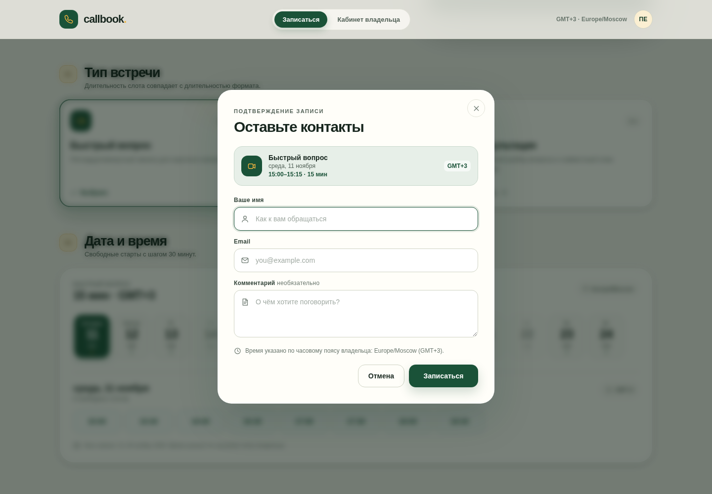
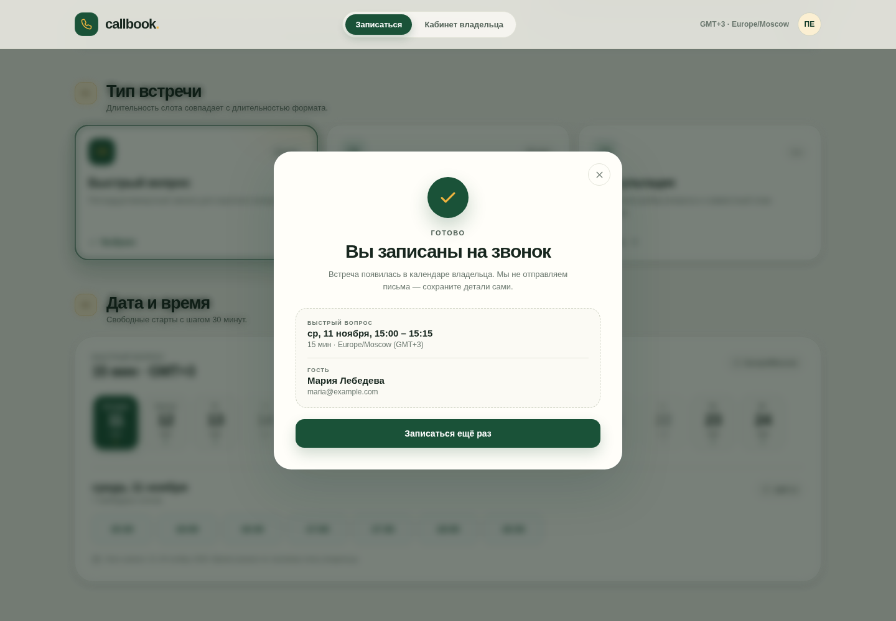

# Календарь звонков (продолжение)

[](https://github.com/ElikCandy2026/ai-for-developers-project-387/actions)

Интегрируйте работу агентов в GitHub проект.

Сервис для бронирования календаря, разработанный совместно с ИИ.

Учебный проект Хекслета: https://ru.hexlet.io/programs/ai-for-developers
Как это должно работать: https://files.hexlet.app/a/2ipc5m

Это продолжение [первого проекта](https://github.com/ElikCandy2026/ai-for-developers-project-386):
исходная спецификация — [issue #8](https://github.com/ElikCandy2026/ai-for-developers-project-386/issues/8),
принятые решения — [issue #1](https://github.com/ElikCandy2026/ai-for-developers-project-386/issues/1)
и [`docs/adr/`](docs/adr/). Критерии ревью — в [`REVIEW.md`](REVIEW.md).

Небольшой законченный сервис бронирования времени по мотивам [Cal.com](https://cal.com/):
владелец публикует типы встреч и свободные слоты, гость без регистрации выбирает
формат, дату и время.

Проект сделан contract-first: источник истины — TypeSpec-контракт, из него
генерируются OpenAPI-спецификация, серверные интерфейсы/модели Spring и
TypeScript SDK, который использует фронтенд.

## Демо

Демо развёрнуто на Render: <https://ai-for-developers-project-387-6sa3.onrender.com>

Бесплатный инстанс засыпает после простоя, поэтому первый запрос может занять до
минуты. SQLite на бесплатном плане живёт на эфемерном диске — данные
сбрасываются при перезапуске, редеплое и пробуждении. Подробнее: [Данные на
Render](#данные-на-render).







## Сценарий: от типа встречи до записи у владельца

Это основной пользовательский путь приложения.

### Владелец создаёт тип встречи

1. Открыть приложение и перейти во вкладку **«Кабинет владельца»**.
2. В блоке **«Новый тип встречи»** заполнить название, например `Знакомство`,
   описание и выбрать длительность `30 минут`.
3. Нажать **«Создать тип встречи»**. Тип сразу появляется в списке типов и на
   странице гостя.

### Гость выбирает слот и записывается

1. Перейти во вкладку **«Записаться»**.
2. Выбрать тип встречи `Знакомство`. Под календарём появится длительность слота
   `30 минут`.
3. В календаре на 14 дней выбрать день со свободными слотами.
4. Нажать на время, например `10:00` (время владельца, `Europe/Moscow`).
5. В диалоге заполнить имя, email и при желании комментарий.
6. Нажать **«Записаться»**. Появится подтверждение с типом встречи, датой и
   временем.

### Владелец видит запись

1. Вернуться во вкладку **«Кабинет владельца»** (страница перезагружает список
   записей при открытии; для обновления вручную есть кнопка **«Обновить»**).
2. В блоке **«Предстоящие встречи»** появляется запись: дата, время, тип встречи,
   имя гостя, email и комментарий.
3. Занятое время исчезает из календаря гостя. При попытке занять его повторно —
   в том числе встречей другого типа — сервер вернёт `409 Conflict`.

В референсном Cal.com путь аналогичен: создать event type → открыть публичную
страницу → выбрать дату и слот → заполнить данные гостя → увидеть booking в
календаре владельца. Регистрация, внешние календари и уведомления в этом проекте
намеренно не реализованы.

## Правила записи

Правила заданы в TypeSpec-контракте (`contract/main.tsp`), отдаются клиенту через
`GET /api/owner` и проверяются на сервере.

| Правило | Значение |
| --- | --- |
| Владелец | один, задан заранее: Пафнутий Евлампиевич |
| Часовой пояс | `Europe/Moscow` (UTC+3, без перехода на летнее время) |
| Рабочие дни | понедельник–пятница |
| Рабочие часы | 10:00–19:00 по времени владельца |
| Окно записи | 14 календарных дней, начиная с сегодняшнего дня по времени владельца |
| Сдвиг окна | каждый календарный день в 00:00 по времени владельца |
| Шаг доступных стартов | 30 минут от начала рабочего дня |
| Длительность слота | равна длительности выбранного типа встречи |
| Допустимая длительность | 15–240 минут, кратно 15 |
| Минимальный запас до встречи | 0 минут (слот должен быть в будущем) |
| Пересечения | запрещены для всех типов встреч; частичное наложение тоже запрещено |
| Смежные встречи | разрешены: следующая может начаться ровно в момент окончания предыдущей |
| Одновременные запросы | два запроса на один слот не могут оба завершиться успешно |

Дни окна возвращаются все 14: выходные и дни без слотов приходят с пустым
массивом `slots`, чтобы интерфейс мог показать полный календарь.

## Стек

- **Контракт:** TypeSpec 1.17 → OpenAPI 3.0.0 (`@typespec/openapi3`).
- **Backend:** Java 21, Spring Boot 3.5.16, Spring Web MVC, Spring JDBC, SQLite
  (`sqlite-jdbc`), Maven.
- **Frontend:** TypeScript, React 19, Vite. Клиентский SDK генерируется из OpenAPI
  через `@hey-api/openapi-ts` — для TypeScript есть готовый генератор клиента.
- **Сборка:** Node 22 (зафиксирован в `.nvmrc` и `engines.node`) и Java 21.
  Vite собирает фронтенд в `frontend/dist`, Maven упаковывает его в jar.
- **Хранилище:** SQLite, файл `./data/call-booking.db` по умолчанию.

Серверные интерфейсы и DTO не написаны руками: OpenAPI Generator (`spring`,
`interfaceOnly`) генерирует `*Api` и модели в `backend/target/generated-sources/openapi`
на этапе `generate-sources`. Контроллер реализует сгенерированные интерфейсы.
Клиентский SDK лежит в `frontend/src/api/generated` и тоже генерируется, а не
пишется вручную.

## Структура проекта

```
.
├── contract/                     TypeSpec-контракт
│   ├── main.tsp                  источник истины API
│   ├── tspconfig.yaml            эмиттер OpenAPI
│   └── tsp-output/openapi/
│       └── openapi.yaml          сгенерированная спецификация (в репозитории)
├── backend/                      Spring Boot + SQLite
│   ├── pom.xml                   генерация серверных интерфейсов и упаковка frontend
│   └── src/
│       ├── main/java/com/callbooking/
│       │   ├── api/              контроллер и обработка ошибок
│       │   ├── application/      use cases и закрытый набор кодов ошибок
│       │   ├── config/           настройки, SQLite, демо-данные
│       │   ├── domain/           scheduling policy, правила слотов и бронирования
│       │   └── persistence/      JDBC-репозитории и атомарная вставка записи
│       ├── main/resources/
│       │   ├── application.yml
│       │   ├── schema.sql
│       │   └── ValidationMessages.properties
│       └── test/                 интеграционные, unit- и ArchUnit-тесты
├── frontend/                     React + TypeScript + Vite
│   ├── openapi-ts.config.ts      генерация SDK
│   ├── dist/                     собранная статика (не в git)
│   └── src/
│       ├── api/generated/        сгенерированный SDK (в репозитории)
│       ├── components/           гость, кабинет владельца, диалог записи
│       ├── data/                 facade над SDK, ApiResult и useResource
│       └── lib/                  форматирование дат
├── Dockerfile                    многостадийная сборка образа
├── opencode.json                 безопасная MCP-конфигурация Render
├── .github/workflows/            CI, opencode, triage, review, lighthouse-audit, release-please
├── .nvmrc                        версия Node для генерации и сборки
├── docs/                         скриншоты и инструкции для агентов
├── Makefile
└── README.md
```

## API

Все моменты времени в запросах и ответах — UTC ISO 8601. Локальные даты
календаря — даты в часовом поясе владельца.

| Метод | Маршрут | Назначение |
| --- | --- | --- |
| `GET` | `/api/owner` | владелец и правила записи |
| `GET` | `/api/meeting-types` | список типов встреч |
| `POST` | `/api/meeting-types` | создать тип встречи |
| `GET` | `/api/meeting-types/{id}` | тип встречи по id |
| `GET` | `/api/meeting-types/{id}/availability` | свободные слоты на актуальное 14-дневное окно |
| `POST` | `/api/bookings` | записаться на слот |
| `GET` | `/api/bookings?includePast=false` | предстоящие встречи всех типов |

Ошибки возвращаются в едином JSON-виде:

```json
{
  "code": "SLOT_TAKEN",
  "message": "Это время уже занято другой встречей. Выберите другой слот."
}
```

Набор кодов закрыт контрактом: семь значений, сгруппированных по HTTP-статусу.
Поле `code` всегда строка; клиент может обрабатывать коды исчерпывающе.

| Код | HTTP | Значение |
| --- | --- | --- |
| `VALIDATION_FAILED` | 400 | данные не прошли Bean Validation: обязательное поле, длина, формат, диапазон или непустота |
| `MALFORMED_REQUEST` | 400 | тело или параметры запроса не удалось разобрать |
| `INVALID_DURATION` | 400 | длительность типа встречи не кратна 15 минутам |
| `MEETING_TYPE_NOT_FOUND` | 404 | тип встречи с указанным id не существует |
| `SLOT_UNAVAILABLE` | 409 | слот вне окна записи, рабочих часов, сетки стартов или уже начался |
| `SLOT_TAKEN` | 409 | слот занят другой встречей, в том числе другого типа |
| `INTERNAL_ERROR` | 500 | непредвиденная ошибка сервера |

Синтаксис запроса (обязательность, длины, шаблоны, диапазон 15–240, email)
проверяет Bean Validation, сгенерированная из контракта; сервер отвечает на такие
ошибки `VALIDATION_FAILED` с русским сообщением и подписью поля. Семантику
календаря (окно, рабочие часы, сетка, notice, кратность длительности и
пересечения) проверяет серверная логика: диапазон длительности относится к
валидации, а её кратность 15 — к `INVALID_DURATION`. Framework-ошибки `405`,
`415` и `406` сохраняют свой статус и не превращаются в `500`.

## Контракт и кодогенерация

TypeSpec-контракт: [`contract/main.tsp`](contract/main.tsp).
Сгенерированная спецификация: [`contract/tsp-output/openapi/openapi.yaml`](contract/tsp-output/openapi/openapi.yaml).

```bash
# Пересобрать OpenAPI из TypeSpec
cd contract
npm ci
npm run compile

# Пересобрать TypeScript SDK из OpenAPI
cd ../frontend
npm ci
npm run generate:api

# Серверные интерфейсы и модели генерируются Maven-плагином
cd ../backend
mvn generate-sources
```

Генерация клиента проверена: `@hey-api/openapi-ts` создаёт типизированные функции
`getOwner`, `listMeetingTypes`, `getAvailability`, `createBooking` и модели
`Owner`, `MeetingType`, `Availability`, `Booking` в `frontend/src/api/generated`.

Компоненты не работают с SDK напрямую: единственная граница — `frontend/src/data`.
Facade `data/api.ts` возвращает `ApiResult<T>` и не выбрасывает исключений,
`useResource` владеет загрузкой, `AbortController` и stale-guard, а `ApiError`
различает `http`, `network`, `unexpected` и `aborted`. Исчерпывающая карта кодов
ошибок делает добавление нового кода в TypeSpec ошибкой сборки, пока его не
обработали на фронтенде. `make verify` проверяет grep-ом, что `App`, компоненты
и `lib/` не импортируют generated-код в обход `data/`.

TypeSpec — единственный источник истины. OpenAPI и TypeScript SDK коммитятся в
репозиторий, поэтому backend собирается без Node, а frontend — без TypeSpec.
`tsp compile` запускается с `--warn-as-error`. Свежесть сгенерированных файлов
проверяет `make check-generated`: он перегенерирует контракт и SDK и падает, если
в `contract/tsp-output` или `frontend/src/api/generated` появились изменённые,
новые или удалённые файлы. Посторонние изменения он игнорирует.

## Установка

Нужны JDK 21, Maven 3.9+, Node.js 22 и npm. Версия Node зафиксирована в `.nvmrc`
(`nvm use`), а также в `engines.node` пакетов `contract` и `frontend`.

```bash
git clone https://github.com/ElikCandy2026/ai-for-developers-project-387.git
cd ai-for-developers-project-387
make install
```

`make install` устанавливает зависимости контракта и фронтенда, а также скачивает
Chromium для Playwright. Зависимости backend Maven скачает при сборке.

## Использование

### Быстрый запуск (всё в одном jar)

```bash
make build
make run
```

`make build` перегенерирует OpenAPI и SDK, собирает фронтенд в `frontend/dist` и
упаковывает его Maven-ом в jar (`target/classes/static`). `make run` сначала
выполняет ту же сборку, затем запускает приложение. Открыть
<http://localhost:8080> — Spring Boot раздаёт фронтенд из jar.

Без `make`:

```bash
cd contract && npm ci && npm run compile && cd ..
cd frontend && npm ci && npm run generate:api && npm run build && cd ..
cd backend && mvn -DskipTests package
java -jar target/call-booking-1.0.0.jar
```

Собранная статика не хранится в git: `frontend/dist` и `backend/target`
игнорируются, а `backend/src/main/resources/static` создаётся только в выводе
сборки.

При первом запуске база создаётся автоматически. По умолчанию добавляются три
демонстрационных типа встреч, если таблица типов пуста. Отключить:

```bash
SEED_DEMO_DATA=false java -jar target/call-booking-1.0.0.jar
```

### Docker

В корне лежит `Dockerfile` с тремя стадиями: Node собирает фронтенд, Maven
упаковывает jar вместе со статикой, runtime-образ содержит только JRE 21 и jar.

```bash
docker build -t callbook .
docker run --rm -e PORT=8080 -p 8080:8080 callbook
```

Приложение стартует автоматически и слушает порт из `PORT` (по умолчанию
`8080`). Чтобы сохранить SQLite между перезапусками, смонтируйте `/app/data`:

```bash
docker run --rm -e PORT=8080 -p 8080:8080 -v callbook-data:/app/data callbook
```

### Render

Публичный стенд: <https://ai-for-developers-project-387-6sa3.onrender.com>

Сервис этого репозитория создан через Render MCP: runtime Docker, `./Dockerfile`,
ветка `main`, free plan. Render сам передаёт `PORT`, приложение читает его из
`server.port`. Пуш в `main` запускает автодеплой. Стенд первого проекта
(`ai-for-developers-project-386-izjw.onrender.com`) остаётся историческим и для
проверок этого репозитория не используется.

Адрес стенда используется workflow `lighthouse-audit` при `target: render`.
Если сервис пересоздадут, задайте repository variable `RENDER_URL`: workflow
возьмёт её вместо значения по умолчанию.

Конфигурация MCP для OpenCode лежит в `opencode.json`, инструкция — в
[`docs/agents/render.md`](docs/agents/render.md). Ключ Render передаётся только
через переменную окружения `RENDER_API_KEY` и в репозиторий не попадает; вход
через OAuth тоже поддерживается.

### Данные на Render

**Да, данные сбрасываются.** На бесплатном плане Render файловая система
контейнера эфемерная: SQLite-файл `/app/data/call-booking.db` теряется при
каждом перезапуске, редеплое и пробуждении после простоя. После старта
приложение создаёт пустую схему заново и, если `SEED_DEMO_DATA=true`, добавляет
три демонстрационных типа встреч. Записи гостей и созданные типы, которых нет в
демо-наборе, не сохраняются.

Для постоянного хранения нужен платный инстанс с Render Disk, смонтированным в
`/app/data`, либо внешняя база. В локальном Docker данные сохраняются, если
смонтировать volume, как показано выше.

Переменные окружения:

| Переменная | По умолчанию | Назначение |
| --- | --- | --- |
| `PORT` | `8080` | порт сервера |
| `DB_PATH` | `./data/call-booking.db` | файл SQLite |
| `SEED_DEMO_DATA` | `true` | демо-типы при пустой базе |
| `VITE_API_BASE_URL` | пусто | адрес API для SDK; по умолчанию same-origin |

### Режим разработки

Терминал 1:

```bash
make dev-backend
```

Терминал 2:

```bash
make dev-frontend
```

Vite откроется на <http://localhost:5173> и проксирует `/api` на `:8080`.

## Тесты

```bash
cd backend
mvn test
```

Интеграционные тесты поднимают приложение на случайном порту и используют
временную SQLite-базу. Проверяются:

- правила владельца и окно в 14 календарных дней;
- сетка слотов, рабочие часы, выходные и длительность слота;
- создание типа встречи и валидация длительности;
- успешная запись и исчезновение слота из календаря;
- частичное пересечение разных типов и разрешённая смежная запись;
- отказ для слота вне окна и вне шага сетки;
- валидация имени и email гостя;
- `404` для неизвестного типа;
- закрытый набор кодов ошибок: непустые имена, строгий email, диапазон
  длительности, битый JSON, сохранение статусов `405` и `415`;
- **10 одновременных запросов на один слот, в том числе от разных типов встреч:
  ровно один `201`, остальные `409`.**

Отдельный drift-тест сверяет `ApplicationErrorCode` с enum'ами, сгенерированными
из TypeSpec, и не даёт наборам кодов разойтись.

### Браузерный тест

```bash
make e2e
```

`make e2e` собирает фронтенд и jar, поднимает настоящее приложение на порту
`4173` с чистой SQLite-базой и демо-типами встреч, затем запускает Playwright.
API не подменяется: тест открывает главную страницу, выбирает тип «Знакомство»,
первый свободный слот, заполняет имя и email, отправляет форму и ждёт
подтверждение. После этого он проверяет через API, что запись сохранена, а
занятый слот больше не предлагается. Браузер скачивается командой
`make e2e-install` (её же вызывает `make install`).

Полная проверка контракта, генерации, фронтенда и тестов:

```bash
make verify
```

`make verify` — единственная точка входа для проверки. Он выполняет
`make check-generated` (свежесть OpenAPI/SDK), запускает линтер (`eslint` и
`tsc --noEmit`), собирает фронтенд, запускает vitest и проверку границы
импортов, затем backend-тесты и браузерный e2e-тест. CI использует Node 22 и
Java 21 и запускает ту же команду (`make install && make verify`), поэтому
«зелено локально» означает «зелено в CI».

| Команда | Что делает |
| --- | --- |
| `make install` | `npm ci` в `contract` и `frontend` + Chromium для Playwright |
| `make generate` | TypeSpec → OpenAPI → TypeScript SDK |
| `make check-generated` | падает при расхождении OpenAPI/SDK с контрактом |
| `make frontend` | сборка фронтенда в `frontend/dist` |
| `make frontend-test` | frontend-тесты (vitest) |
| `make frontend-boundary` | grep-проверка: UI не импортирует generated SDK |
| `make lint` | статические проверки: ESLint и `tsc --noEmit` |
| `make test` | backend-тесты (без сборки фронтенда) |
| `make e2e-install` | скачать Chromium для Playwright |
| `make e2e` | браузерный e2e-тест на собранном приложении и чистой базе |
| `make build` | генерация, фронтенд и jar с фронтендом внутри |
| `make verify` | `check-generated` + линтер + фронтенд + vitest + граница + тесты + e2e |
| `make run` | сборка и запуск приложения |
| `make clean` | удаляет `backend/target` и `frontend/dist` |

## Агент в GitHub

Интерактивный workflow
[`.github/workflows/opencode.yml`](.github/workflows/opencode.yml) запускает
OpenCode по команде в комментарии.

Напишите команду в issue или в комментарии к строке diff:

```text
/oc объясни, какие правила применяются к этому слоту
```

Агент отвечает комментарием в том же обсуждении. Если попросить изменить код, он
работает в ветке и при доступных правах открывает или обновляет pull request.
Каждый запуск и его логи видны в Actions, в job `opencode`.

| Параметр | Значение |
| --- | --- |
| События | `issue_comment` — комментарий к issue или pull request; `pull_request_review_comment` — комментарий к строке diff |
| Фильтр событий | `types: [created]`: редактирование комментария повторный запуск не вызывает |
| Команды | `/oc` и `/opencode` в начале или внутри текста (`mentions: /opencode,/oc`) |
| Модель | `opencode/deepseek-v4.1-flash-free` (бесплатная модель OpenCode Zen) |
| Назначение | ответить на вопрос по issue/PR, разобрать код или внести изменение в ветку/PR |
| Где смотреть результат | ответ агента в issue/PR и прогон в [Actions](https://github.com/ElikCandy2026/ai-for-developers-project-387/actions/workflows/opencode.yml); логи — в job `opencode` |
| Авторы | только `OWNER`, `MEMBER` и `COLLABORATOR`, причём в тексте должна быть команда |
| Боты | комментарии с `user.type == 'Bot'` и логином `[bot]` игнорируются, чтобы агент не отвечал на собственные сообщения |
| Share | `share: false` — сессии OpenCode не публикуются; в issue/PR попадает только ответ агента |
| Таймаут | `timeout-minutes: 30` |
| Параллельность | `concurrency` группирует запуски по номеру issue или PR, поэтому по одному обсуждению одновременно идёт не больше одного прогона |

Для недоверенных авторов, в том числе в комментариях к fork-PR, job не
запускается, поэтому секреты им не передаются. Комментарии ботов отсекаются
отдельно: они не должны вызывать агента даже при наличии команды в тексте.

`cancel-in-progress: false` ставит новый запуск в очередь, а не обрывает текущий.
Кнопка **Cancel workflow** останавливает текущий прогон, **Disable workflow**
отключает будущие. Запрос, уже отправленный провайдеру модели, может продолжиться
по правилам провайдера; при необходимости ключ отзывается в OpenCode Console.

Для бесплатной модели ключ не обязателен. Для платной модели добавьте
`OPENCODE_API_KEY` в **Settings → Secrets and variables → Actions**. Workflow
использует `GITHUB_TOKEN` (`use_github_token: true`), поэтому отдельное приложение
OpenCode устанавливать не нужно.

### Проектные skills

Чистый runner GitHub Actions не имеет глобальных skills, поэтому нужные навыки
лежат в репозитории: [`.opencode/skills/`](.opencode/skills/). Они скопированы из
[`mattpocock/skills`](https://github.com/mattpocock/skills) на коммите
`5863806` (MIT) и обновляются вручную по инструкции в
[`.opencode/skills/README.md`](.opencode/skills/README.md).

| Skill | Назначение |
| --- | --- |
| `to-spec` | превратить обсуждение в спецификацию и опубликовать её как issue |
| `to-tickets` | разбить спецификацию на tracer-bullet тикеты с блокировками |
| `implement-spec` | реализовать спецификацию по тикетам на integration-ветке |
| `tdd` | red-green цикл; вызывается из `implement-spec` |
| `code-review` | ревью изменений по стандартам и спецификации; вызывается из `implement-spec` |
| `codebase-design` | словарь глубоких модулей и швов; справочник для `tdd` |

Три основных навыка помечены `disable-model-invocation: true`: модель не видит их
в списке и не вызовет случайно. Чтобы загрузить навык, укажите его явно:

```text
/oc @to-spec собери спецификацию из этого обсуждения
/oc @to-tickets #N разбей спецификацию на тикеты
/oc @implement-spec #N реализуй спецификацию по тикетам
```

Перед вызовом модели `opencode.yml` проверяет, что все шесть `SKILL.md` на месте.
Workflow [`skills-smoke.yml`](.github/workflows/skills-smoke.yml) дополнительно
запускается вручную и на PR, которые меняют skills: он проверяет frontmatter и
источник `.opencode/skills` в конфиге, а затем загружает `to-spec`, `to-tickets` и
`implement-spec` через инструмент `skill` и убеждается, что загружен именно
проектный экземпляр. Отчёт и JSON-логи прогона сохраняются в артефакте
`skills-smoke`. В PR из форков вызов модели пропускается, чтобы код форка не
запускал модель за счёт репозитория; там выполняются только проверки файлов и
конфига.

Проверка на чистом раннере: прогон
[43367738307](https://github.com/ElikCandy2026/ai-for-developers-project-387/actions/runs/43367738307)
загрузил все три навыка из
`/home/runner/work/ai-for-developers-project-387/ai-for-developers-project-387/.opencode/skills/<id>`.
Таблица с путями есть в summary прогона, JSON-логи вызовов `skill` — в артефакте
`skills-smoke`. Первый прогон
([43367569658](https://github.com/ElikCandy2026/ai-for-developers-project-387/actions/runs/43367569658))
пропустил загрузку: условие требовало `OPENCODE_API_KEY`, которого в репозитории
нет, хотя бесплатная модель работает без ключа. Условие заменили на проверку
события, а каждый вызов ограничили `timeout 300`.

### Автотриаж новых issues

Workflow [`.github/workflows/triage.yml`](.github/workflows/triage.yml)
запускается на `issues: [opened]` и просит OpenCode разобрать новое обращение:
определить категорию (`bug`/`enhancement`), поставить ровно одну метку состояния
и оставить комментарий с итогами триажа.

| Параметр | Значение |
| --- | --- |
| Событие | `issues: [opened]` — только создание issue |
| Повторный запуск | `workflow_dispatch` с номером issue, если прогон упал |
| Prompt | инструкция разобрать issue по `docs/agents/` и не менять код |
| Модель | `opencode/glm-5.3-flash-free`; переопределяется переменной `TRIAGE_MODEL` |
| Авторы | только `OWNER`, `MEMBER` и `COLLABORATOR`; боты игнорируются |
| Таймаут | `timeout-minutes: 30` |
| Параллельность | `concurrency` по номеру issue, `cancel-in-progress: false` |
| Пропуск | issue с `needs-triage`, `needs-info`, `ready-for-agent`, `ready-for-human` или `wontfix` повторно не разбираются |

Тикеты, созданные через `to-spec` и `to-tickets`, сразу получают
`ready-for-agent` (или `ready-for-human`), поэтому автотриаж их пропускает.
Результат прогона виден в Actions, в job `triage`.

GitHub action `anomalyco/opencode/github` принимает только `issue_comment` и
`pull_request_review_comment`, поэтому на `issues: opened` workflow запускает CLI
`opencode run` напрямую. Агент работает с issue через `gh`: ставит метки, пишет
комментарий и при необходимости закрывает issue. Шаг `Verify the triage result`
проверяет, что на issue ровно одна метка состояния, ровно одна категория
(`bug`/`enhancement`) и есть комментарий с маркером
`> *This was generated by AI during triage.*`; иначе job падает.

### Авторевью pull request

Workflow [`.github/workflows/review.yml`](.github/workflows/review.yml)
запускается на `pull_request` и ревьюит diff автоматически, без команды `/oc`.
Критерии лежат в [`REVIEW.md`](REVIEW.md): соответствие задаче, корректность и
тесты, контракт и данные, безопасность, качество кода, документация, риск и
откат. Агент не меняет код, а публикует в PR один комментарий с блокирующими и
неблокирующими замечаниями.

| Параметр | Значение |
| --- | --- |
| События | `pull_request`: `opened`, `reopened`, `synchronize`, `ready_for_review` |
| Пропуск | черновики, PR из форков и автоматические release-PR (`release-please--branches--*`) не ревьюятся: у форков токен только на чтение, а release-PR создаёт `github-actions[bot]` |
| Критерии | [`REVIEW.md`](REVIEW.md), подключён в `prompt` |
| Модель | `opencode/deepseek-v4.1-flash-free` |
| Права | `contents: read`, `pull-requests: write`, `issues: write`, `actions: read` |
| Токен для action | `GITHUB_TOKEN` передаётся и как `GITHUB_TOKEN`, и как `TOKEN`: `anomalyco/opencode/github` читает `TOKEN`, хотя input `use_github_token` экспортирует только `USE_GITHUB_TOKEN` |
| Лимит модели | при ответе `Free usage limit reached` action повторяет запрос с `retry-after`; прогон завершается ошибкой без комментария ревью. Это отсутствие результата, а не «замечаний нет» |
| Таймаут | `timeout-minutes: 30` |
| Устаревшее ревью | `concurrency` по номеру PR с `cancel-in-progress: true`: новый коммит отменяет предыдущий прогон |
| Лимит запусков | `MAX_RUNS: "5"` прогонов workflow на PR; проверка выполняется отдельным шагом до вызова модели, при превышении модель не запускается |
| Учёт лимита | считаются все прогоны `review.yml` для ветки PR, включая текущий и отменённые, поэтому серия быстрых пушей не обходит лимит |
| Шаблон PR | [`.github/pull_request_template.md`](.github/pull_request_template.md) с разделами «Проверки», «Риск» и «Откат» |
| Где смотреть результат | комментарий в PR и прогон в [Actions](https://github.com/ElikCandy2026/ai-for-developers-project-387/actions/workflows/review.yml) |

Комментарий авторевью начинается скрытым маркером
`<!-- opencode-auto-review -->`, чтобы его было легко отличить от остальных
сообщений в PR.

PR, созданные от `GITHUB_TOKEN` (например, release-please), не запускают этот
workflow: GitHub не шлёт события на действия такого токена.

При добавлении новых workflow дополняйте этот раздел: событие, модель,
назначение и место просмотра результатов.

### Аудит Lighthouse по расписанию

Workflow [`.github/workflows/lighthouse-audit.yml`](.github/workflows/lighthouse-audit.yml)
раз в сутки собирает приложение, поднимает его на чистой SQLite и снимает отчёт
Lighthouse. Агент читает отчёт, выбирает одну конкретную находку и создаёт
отдельный issue с проблемой, предлагаемым действием и ссылкой на прогон. Если
находок нет, агент пишет об этом в журнал аудитов.

| Параметр | Значение |
| --- | --- |
| События | `schedule` и `workflow_dispatch` в одном файле |
| Расписание | `cron: '17 3 * * *'` с `timezone: Europe/Moscow` — один запуск в сутки в 03:17 по Москве |
| Ручной запуск | `workflow_dispatch` с выбором `mode`: `live` — реальный аудит, `training` — подготовленный учебный отчёт, `baseline` — 5 прогонов Lighthouse без агента и создания issue, `regression` — намеренное повторное появление исправленной проблемы |
| Цель | `workflow_dispatch` с выбором `target`: `local` — сборка на чистой SQLite (по умолчанию), `render` — развёрнутый стенд <https://ai-for-developers-project-387-6sa3.onrender.com> |
| Baseline | в режиме `baseline` отчёты пишутся в `lighthouse-report/run-1…run-5`, а медианы метрик и разбивка main-thread work попадают в summary прогона; это база для сравнения до/после оптимизаций |
| Прогрев | перед измерением workflow делает один прогревочный прогон Lighthouse и не учитывает его: первый прогон после старта JVM завышает main-thread work и TBT из-за конкуренции с прогревом Spring Boot |
| Приложение | `make build`, затем `java -jar backend/target/call-booking-1.0.0.jar` на `127.0.0.1:8080` с чистой БД и `SEED_DEMO_DATA=true` |
| Отчёт | `lighthouse-report/report.json` и `report.html` в корне рабочего дерева; артефакт `lighthouse-report` хранится 14 дней |
| Отчёты в git | не попадают: каталог `lighthouse-report/` исключён в `.gitignore` и не коммитится |
| Агент | `opencode run --model opencode/deepseek-v4.1-flash-free`; CLI используется потому, что action `anomalyco/opencode/github` принимает только комментарии, а не `schedule` |
| Права | `contents: read`, `issues: write`; `GITHUB_TOKEN` передаётся агенту как `GH_TOKEN` — это режим `use_github_token: true`, поэтому `id-token: write` не нужен |
| Таймаут | `timeout-minutes: 30` |
| Параллельность | `concurrency: lighthouse-audit` с `cancel-in-progress: false`: одновременно идёт не больше одного аудита |
| Дубли | перед созданием issue агент ищет открытые задачи по `audit id`; при повторе без новых сведений не создаёт задачу и не пишет одинаковый комментарий |
| Журнал | issue с меткой `lighthouse-log` создаётся автоматически; туда агент пишет итог прогона |
| Учебная задача | в режиме `training` отчёт помечен `trainingFixture`, issue получает метку `training` и явное предупреждение, что это не подтверждённый дефект |
| Повторное появление | реестр [`.github/lighthouse-fixed-audits.json`](.github/lighthouse-fixed-audits.json) хранит для исправленных находок прежний issue, исправляющий PR и коммит. Если зарегистрированный audit снова получает score < 1, workflow без участия модели создаёт issue с меткой `lighthouse-regression` и разделом `## Повторное появление` со ссылками на прежнюю задачу и исправление. Режим `regression` воспроизводит `uses-text-compression`, запуская приложение с `SERVER_COMPRESSION_ENABLED=false` |
| Отсутствие данных | если приложение не стартовало, стенд Render не ответил, Lighthouse не снял отчёт или агент не смог его разобрать, workflow пишет в журнал «Данных нет» с причиной. Это отдельный результат: он не подтверждает, что дефект исправлен |

Расписание работает только для файла в основной ветке. GitHub может задержать
или пропустить запуск при высокой нагрузке, а в публичном репозитории отключает
расписание после 60 дней без активности. Поэтому для проверки сценария
используется ручной запуск из `main`: он не зависит от ночного расписания.

#### Повторное появление исправленной проблемы

Реестр `.github/lighthouse-fixed-audits.json` — единственный источник сведений о
том, что находка уже была исправлена. Для каждой записи хранятся:

- `issue` — прежняя задача;
- `fixPr` — PR, через который исправление попало в `main`;
- `fixCommit` — коммит исправления;
- `fixedValue` — значение метрики после исправления;
- `page` — страница, на которой проблему исправляли.

Проверка выполняется до агента и не зависит от модели. Если зарегистрированный
audit снова получает score меньше 1, workflow:

1. создаёт issue с метками `lighthouse-audit` и `lighthouse-regression`;
2. добавляет раздел `## Повторное появление` со ссылками на прежнюю задачу,
   исправляющий PR и коммит;
3. указывает, какое значение было после исправления и какое стало сейчас;
4. пропускает агента, чтобы не создать дубль.

Режим `regression` нужен, чтобы проверить саму проверку: приложение
запускается с `SERVER_COMPRESSION_ENABLED=false`, и дефект #23 (сжатие) обязан
появиться снова. Перед Lighthouse workflow проверяет, что JS-ассет действительно
отдаётся без `Content-Encoding: gzip`. Если дефект не воспроизвёлся, запуск
пишет «Данных нет», а не «исправлено».

#### Отсутствие данных

«Данных нет» — отдельный результат, не равный «находок нет». Он появляется,
когда приложение не ответило, стенд Render не проснулся, Lighthouse не создал
отчёт, отчёт содержит `runtimeError` или агент не смог его разобрать (например,
исчерпан лимит бесплатной модели). В этом случае в журнал аудитов добавляется
комментарий с причиной и явной строкой: отсутствие данных не подтверждает, что
дефект исправлен. Запуск при этом завершается ошибкой, чтобы пропуск не
выглядел как успешный аудит.

#### Результаты ручных запусков

Все запуски сделаны из `main` 12 ноября 2026 года.

| Режим | Прогон | Результат |
| --- | --- | --- |
| `live` | [43153473429](https://github.com/ElikCandy2026/ai-for-developers-project-387/actions/runs/43153473429) | Агент создал [#19](https://github.com/ElikCandy2026/ai-for-developers-project-387/issues/19) про `mainthread-work-breakdown` (2.3 s, Performance 79). Job упал только на шаге проверки: в нём не был проброшен `GH_TOKEN`. |
| `live` | [43153918170](https://github.com/ElikCandy2026/ai-for-developers-project-387/actions/runs/43153918170) | Успешно. Агент создал [#20](https://github.com/ElikCandy2026/ai-for-developers-project-387/issues/20) про `aria-allowed-role`: 14 кнопок дат с недопустимой ролью `listitem`, указаны `frontend/src/components/GuestBooking.tsx:310` и способ исправления. |
| `training` | [43154329494](https://github.com/ElikCandy2026/ai-for-developers-project-387/actions/runs/43154329494) | Успешно. Агент создал учебную [#21](https://github.com/ElikCandy2026/ai-for-developers-project-387/issues/21) про LCP 5.2 s, с меткой `training` и предупреждением, что это не подтверждённый дефект. |
| `training` повторно | [43154502330](https://github.com/ElikCandy2026/ai-for-developers-project-387/actions/runs/43154502330) | Успешно. Агент нашёл [#21](https://github.com/ElikCandy2026/ai-for-developers-project-387/issues/21), записал `duplicate #21`, не создал новую задачу и не добавил повторный комментарий. |
| `baseline` без прогрева | [43170641433](https://github.com/ElikCandy2026/ai-for-developers-project-387/actions/runs/43170641433) | 5 прогонов. Первый — TBT 648 ms и main-thread 2.1 s, остальные — TBT 0 ms. Показал, что первый прогон после старта измеряет холодный JVM, а не установившееся состояние. |
| `baseline` с прогревом | [43171216961](https://github.com/ElikCandy2026/ai-for-developers-project-387/actions/runs/43171216961) | 5 прогретых прогонов: Performance 93, TBT 0 ms, main-thread 672 ms, LCP 2.4 s. Это baseline для [#19](https://github.com/ElikCandy2026/ai-for-developers-project-387/issues/19). |
| `baseline` после сжатия | [43175203669](https://github.com/ElikCandy2026/ai-for-developers-project-387/actions/runs/43175203669) | 5 прогретых прогонов: Performance 98, TBT 0 ms, FCP 1.36 s, LCP 1.53 s, transfer 84 KiB, `uses-text-compression` = 1. |
| `regression`, `target=local` | [43181808767](https://github.com/ElikCandy2026/ai-for-developers-project-387/actions/runs/43181808767) | Успешно. Приложение запущено без сжатия, аудит снова увидел `uses-text-compression` (194 KiB) и создал [#29](https://github.com/ElikCandy2026/ai-for-developers-project-387/issues/29) с разделом `## Повторное появление`: ссылки на [#23](https://github.com/ElikCandy2026/ai-for-developers-project-387/issues/23), [PR #24](https://github.com/ElikCandy2026/ai-for-developers-project-387/pull/24) и коммит `0647558`. Агент не вызывался. |
| `live`, `target=render`, недоступный стенд | [43182094039](https://github.com/ElikCandy2026/ai-for-developers-project-387/actions/runs/43182094039) | Ожидаемо упал на `Wait for Render`: временно подставленный `RENDER_URL` не отвечал 180 с. В журнал [#18](https://github.com/ElikCandy2026/ai-for-developers-project-387/issues/18) добавлено «Данных нет» с причиной и оговоркой, что это не подтверждает исправление. |

Отчёт каждого прогона лежит в артефакте `lighthouse-report` (JSON и HTML,
хранение 14 дней); итоги агента продублированы в журнале
[#18](https://github.com/ElikCandy2026/ai-for-developers-project-387/issues/18)
и в summary прогона. В коммиты отчёты не попали: каталог `lighthouse-report/`
исключён в `.gitignore`.

#### Выводы о работе агента

- На структурированном отчёте агент выбирает конкретную находку, а не общий
  «низкий Performance»: в #20 он доходит до `file:line` и предлагает два
  варианта исправления, в #19 разбирает вклад Script Evaluation и Style & Layout.
- Дедупликация работает, когда совпадает `audit id`. Два live-прогона выбрали
  разные находки (#19 и #20), поэтому обе задачи законно остались открытыми;
  повторный `training` с тем же LCP корректно дал `duplicate #21`.
- Первый live-прогон показал, что мало создать issue: проверка результата должна
  иметь собственный `GH_TOKEN` и не зависеть от гонки при поиске журнала по
  метке. После исправления успешный прогон подтверждает и создание задачи, и
  ссылку на неё.
- Для `schedule` нужен журнал issue: у запуска нет пользовательского
  комментария, а артефакт временный. Комментарий в #18 остаётся доступным
  выводом агента, даже когда находок нет.
- Бесплатная модель подходит для разбора отчёта, но отвечает не мгновенно;
  `timeout-minutes: 30` покрывает сборку и Lighthouse, а вызов агента ограничен
  отдельными 10 минутами.
- Baseline показал, что первый прогон Lighthouse после старта приложения
  завышает main-thread work и TBT: он конкурирует с прогревом Spring Boot.
  Поэтому workflow делает прогревочный прогон и не учитывает его. После
  прогрева Performance = 93, TBT = 0, main-thread work = 672 ms, а исходные
  2.3 s из #19 не воспроизводятся.
- gzip для статики и JSON снизил transfer с 278 до 84 KiB, FCP с 2.26 до
  1.36 s, LCP с 2.4 до 1.53 s, а Performance вырос с 93 до 98. Аудит
  `uses-text-compression` теперь равен 1.
- #20 и #23 исправлены, #19 после прогрева не воспроизводится. Unused CSS и
  render-blocking отдельно не берём: на прогретом приложении они не создают
  проблем.
- Повторное появление проверяется детерминированно, без модели: реестр
  исправленных находок связывает новый issue с прежней задачей, исправляющим PR
  и коммитом. Это надёжнее, чем надеяться, что агент сам найдёт закрытую задачу.
- «Данных нет» — не то же самое, что «находок нет». Недоступный стенд Render,
  упавший Lighthouse или исчерпанный лимит бесплатной модели дают отдельный
  результат с явной оговоркой, что исправление не подтверждено.
- Бесплатная модель может отвечать `Free usage limit reached` с `retry-after`
  на много часов и повторять запрос. Поэтому вызов агента ограничен 10 минутами,
  а отсутствие результата записывается как «Данных нет», а не висит до общего
  таймаута job.
- Стенд Render на free plan засыпает: перед аудитом workflow ждёт `/api/owner`
  до 180 секунд. Если стенд не проснулся, это отсутствие данных, а не чистое
  исправление.
- `regression` подтвердил связку на практике: [#29](https://github.com/ElikCandy2026/ai-for-developers-project-387/issues/29)
  ссылается на #23, PR #24 и коммит `0647558`. Проверка сработала без модели,
  поэтому лимит бесплатного агента на неё не влияет.
- Недоступный стенд дал именно «Данных нет» в журнале #18, а не «находок нет»:
  отсутствие отчёта не позволяет утверждать, что дефект исправлен.

## Релизы

Коммиты в `main` следуют Conventional Commits: `feat` поднимает minor, `fix` —
patch, а `!` или `BREAKING CHANGE` — major. Отдельный workflow
`release-please` (`.github/workflows/release-please.yml`, настройки в
`release-please-config.json` и `.release-please-manifest.json`) на каждый push в
`main` открывает или обновляет release-PR с новой версией, `CHANGELOG.md` и
`version.txt`. Ручные правки этих файлов вне release-PR не нужны: слияние PR
создаёт тег и GitHub Release.

PR создаётся от `GITHUB_TOKEN`, поэтому GitHub не запускает на нём остальные
workflow. Если нужны проверки на самом release-PR, workflow нужно перевести на
отдельный PAT-секрет.

## Как обеспечена защита от двойной записи

Используются три уровня:

1. **Сериализация внутри persistence-модуля** — `BookingRepository.tryInsert`
   держит fair `ReentrantLock` вокруг транзакции и коммитит до освобождения
   блокировки.
2. **Транзакционная проверка пересечения** — внутри той же транзакции перед
   вставкой выполняется запрос
   `NEW.start < existing.end AND NEW.end > existing.start`.
3. **SQLite-триггер** `trg_bookings_prevent_overlap` — `BEFORE INSERT` прерывает
   вставку с `booking_overlap`, если интервал пересекается с уже существующим.
   Это защищает и при нескольких экземплярах приложения. SQLite сериализует
   писателей, включены WAL и `busy_timeout`.

`tryInsert` возвращает `Inserted` или `SlotTaken`; SQLite-исключение и
`DataAccessException` не покидают persistence. `BookingService` только
валидирует календарь через `SchedulingPolicy` и маппит `SlotTaken` в публичный
`SLOT_TAKEN`.

Смежные интервалы не пересекаются: `10:00–11:00` и `11:00–11:30` допустимы,
`10:00–11:00` и `10:30–11:00` — нет.

## Ограничения

- Нет авторизации и личных кабинетов: владелец один и задан конфигурацией.
- Нет интеграций с внешними календарями, email/SMS-уведомлений и видеозвонков.
- Нет отмены и переноса записи.
- Приложение рассчитано на один экземпляр; SQLite-триггер — дополнительная
  защита, но не замена распределённой блокировке при горизонтальном
  масштабировании.

---

<details>
<summary>Автоматические тесты Хекслета</summary>

Тесты запускаются на каждый коммит. За запуск отвечает файл `.github/workflows/hexlet-check.yml` — не удаляйте и не переименовывайте ни его, ни репозиторий.

</details>

## О Хекслете

[Хекслет](https://ru.hexlet.io/) — школа программирования: авторские программы обучения с практикой, поддержкой наставников и реальными проектами, которые остаются в резюме. Этот репозиторий — один из таких проектов.

Автор: ElikCandy
